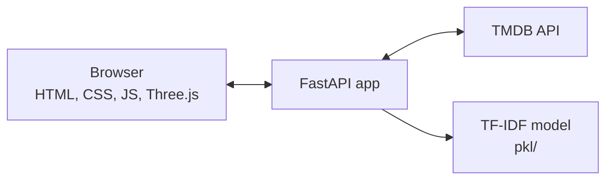

<div align="center">

# CineVerse

**Discover movies through an interactive 3D carousel and get recommendations based on what a film is actually about.**

[**Live Demo**](https://cineverse-2czl.onrender.com) · [API Reference](#api-reference) · [Run Locally](#getting-started)


</div>

> The demo runs on Render's free plan. After 15 idle minutes, the first visit can take about a minute while the service wakes up.

## Overview

CineVerse combines a TF-IDF recommendation model with live data from [TMDB](https://www.themoviedb.org). Browse what's trending, search any title, and open a movie to see similar films.

Recommendations work for new releases too. Instead of looking a title up in the training data, CineVerse vectorizes the movie's current TMDB details with the trained model, so a film doesn't need to be in the dataset to get results.

## Features

- **3D poster carousel:** drag, click, or use the arrow keys to browse, with a background that picks up each poster's colors
- **Four live feeds:** Trending, Top Rated, Upcoming, and Now Playing
- **Instant search:** results and suggestions update as you type
- **Two kinds of recommendations:** content-based matches from the TF-IDF model, plus related movies from TMDB
- **Movie pages:** rating, runtime, genres, tagline, and overview
- **Responsive and accessible:** works on phones, supports keyboard navigation and reduced motion, and falls back to a poster grid when WebGL isn't available

## How It Works



FastAPI serves both the frontend and the JSON API from one app, so there is no separate frontend deployment.

### Recommendation pipeline

Opening a movie calls `GET /movie/id/{tmdb_id}/similar`, which builds two lists:

**Similar Movies (content-based)**

1. Fetch the movie's overview, genres, and tagline from TMDB.
2. Vectorize that text with the trained TF-IDF model.
3. Compute cosine similarity against every movie in the dataset.
4. Multiply each score by `log(1 + popularity)` and drop movies with a popularity below 5, which keeps obscure titles out.
5. Keep only movies that share a genre with the one being viewed.
6. Match each title to TMDB, accepting exact title matches only so a card can't show the wrong poster.

**More Like This (TMDB)**

Uses TMDB's recommendations, then falls back to its similar-movie results, and finally to popular movies in the same genre. Anything already listed under Similar Movies is removed.

## Tech Stack

| Layer | Technology |
| --- | --- |
| Frontend | HTML, CSS, vanilla JavaScript, Three.js |
| Backend | FastAPI, Uvicorn, HTTPX |
| Machine learning | scikit-learn (TF-IDF), NumPy, SciPy, pandas |
| Data | TMDB API, `movies_metadata.csv` for training |
| Hosting | Render |

## Getting Started

### Prerequisites

- Python 3.11 (the pinned dependencies don't install on Python 3.14)
- A free [TMDB API key](https://www.themoviedb.org/settings/api)

### Installation

```bash
git clone https://github.com/supremeinferno/cineverse.git
cd cineverse

python3.11 -m venv .venv
source .venv/bin/activate
pip install -r requirements.txt

echo "TMDB_API_KEY=your_key_here" > .env

uvicorn main:app --reload
```

Open http://127.0.0.1:8000. Interactive API docs are at [`/docs`](http://127.0.0.1:8000/docs).

### Environment variables

| Variable | Required | Description |
| --- | --- | --- |
| `TMDB_API_KEY` | Yes | Your TMDB API key. The app won't start without it. |

## API Reference

| Method | Endpoint | Description |
| --- | --- | --- |
| `GET` | `/health` | Health check |
| `GET` | `/home?category=&limit=` | Movie feed: `trending`, `popular`, `top_rated`, `upcoming`, or `now_playing` |
| `GET` | `/tmdb/search?query=&page=` | Search TMDB by keyword |
| `GET` | `/movie/id/{tmdb_id}` | Movie details |
| `GET` | `/movie/id/{tmdb_id}/similar?limit=` | Similar Movies and More Like This lists |
| `GET` | `/movie/search?query=` | Best match for a query, with its details and recommendations |
| `GET` | `/recommend/tfidf?title=&top_n=` | TF-IDF recommendations for a title in the dataset |
| `GET` | `/recommend/genre?tmdb_id=&limit=` | Popular movies in the same genre |

**Example:** `GET /movie/id/155/similar?limit=1`

```json
{
  "similar": [
    {
      "tmdb_id": 49026,
      "title": "The Dark Knight Rises",
      "poster_url": "https://image.tmdb.org/t/p/w500/...",
      "release_date": "2012-07-17",
      "vote_average": 7.8,
      "overview": "..."
    }
  ],
  "more_like_this": [
    {
      "tmdb_id": 268,
      "title": "Batman",
      "poster_url": "https://image.tmdb.org/t/p/w500/...",
      "release_date": "1989-06-21",
      "vote_average": 7.235,
      "overview": "..."
    }
  ]
}
```

## Project Structure

```text
cineverse/
├── main.py               # FastAPI app: API routes, recommendations, frontend pages
├── static/
│   ├── index.html        # Page shell
│   ├── app.js            # Routing, views, search, API calls
│   ├── three-mode.js     # 3D carousel
│   └── style.css         # Styles
├── pkl/                  # Trained model and processed dataset
├── movies.ipynb          # Data preparation and model training
├── movies_metadata.csv   # Training data
├── render.yaml           # Render deployment config
├── .python-version       # Python version used on Render
└── requirements.txt      # Pinned dependencies
```

## Deployment

The repo includes a [`render.yaml`](render.yaml) Blueprint. To deploy your own copy:

1. In Render, choose **New → Blueprint** and connect your fork.
2. Enter your `TMDB_API_KEY` when prompted.

To configure a web service manually, use these settings:

| Setting | Value |
| --- | --- |
| Runtime | Python 3 |
| Build command | `pip install -r requirements.txt` |
| Start command | `uvicorn main:app --host 0.0.0.0 --port $PORT` |
| Health check path | `/health` |

## Retraining the Model

Run [`movies.ipynb`](movies.ipynb) from the project root. It reads `movies_metadata.csv` and saves `df.pkl`, `indices.pkl`, `tfidf.pkl`, and `tfidf_matrix.pkl` to the root folder. Move those four files into `pkl/`, where the app loads them on startup.

## Known Limitations

- **Older training data:** Similar Movies can only suggest films in the dataset, so it leans toward older titles. More Like This comes from TMDB and includes recent releases.
- **No server-side caching:** every page load calls TMDB again, so heavy traffic could run into rate limits.
- **WebGL fallback:** without WebGL, or if Three.js can't load from its CDN, posters appear in a flat grid.

## Roadmap

- [ ] Retrain the model on a newer dataset
- [ ] Cache TMDB responses on the server
- [ ] Add automated tests
- [ ] User accounts and watchlists
- [ ] Personalized recommendations based on viewing history

## Contributors

[](https://github.com/supremeinferno/cineverse/graphs/contributors)

## Author

**Pranav Garg** · [GitHub](https://github.com/supremeinferno)

## Acknowledgments

Movie data and images are provided by [TMDB](https://www.themoviedb.org). This product uses the TMDB API but is not endorsed or certified by TMDB.
